# Low Poly Halloween Pack for Roblox

A 66-model Halloween asset pack for Roblox by **sumiii61**.

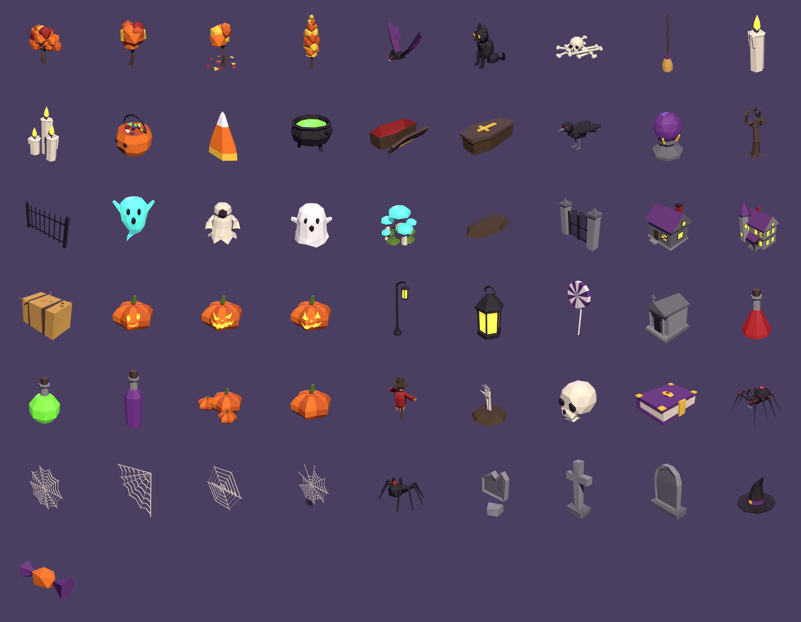

## Highlights

- **55 faceted low-poly models.** They share one 256x256 palette texture, so a whole scene uses a single texture.
- **11-model bonus set** with its own textures:
  - a Watching Eye that turns to stare at the nearest player
  - claw-hand statues, a mimic chest, a reaper scythe, cauldrons and mushrooms
- **4 rigged, animated creatures:**

  | Spider Boss attack | Spider Boss walk | Bat | Black cat | Crow |
  |---|---|---|---|---|
  | 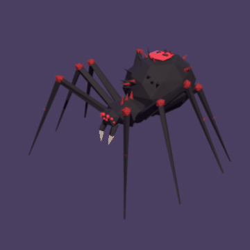 | 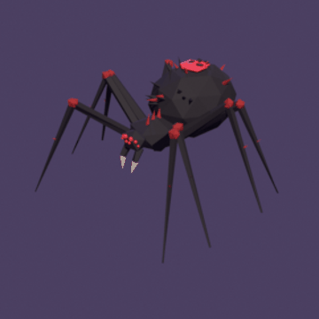 | 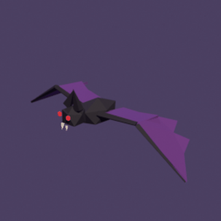 | 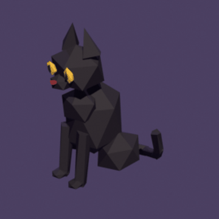 | 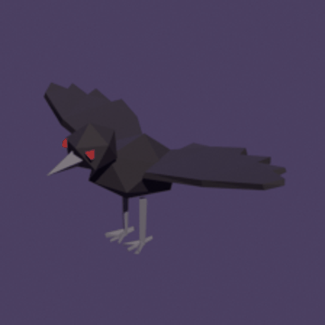 |

- **18 inventory items:** 17 holdable Tools with icons, plus a wearable Witch Hat.
- **Falling-leaves effect** for the autumn trees, built on a ParticleEmitter:

  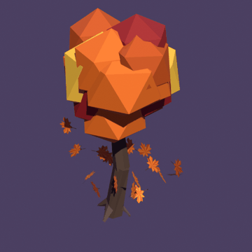

- **Glowing parts:** jack-o'-lanterns, windows, potions and eyes use Neon with soft PointLights.
- **Roblox-ready:** drop-in `.rbxm` files and setup scripts are included. Scale is 1 unit = 1 stud and pivots sit on the ground.

## A few models

| | | | |
|---|---|---|---|
| 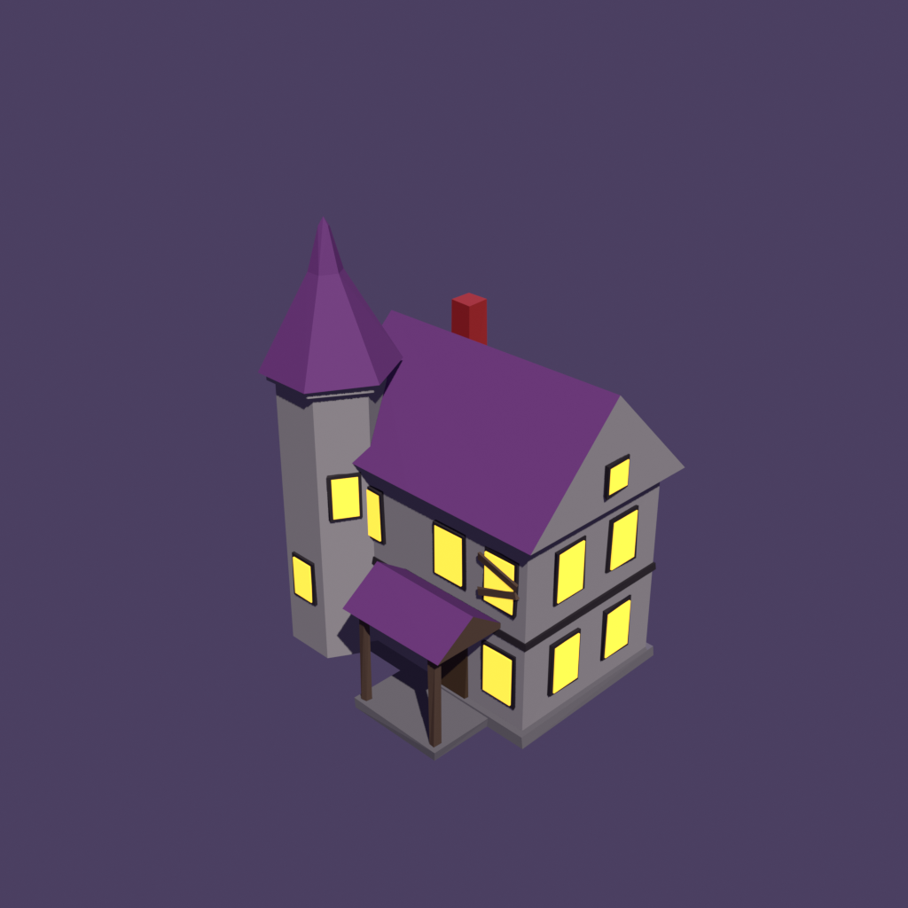 | 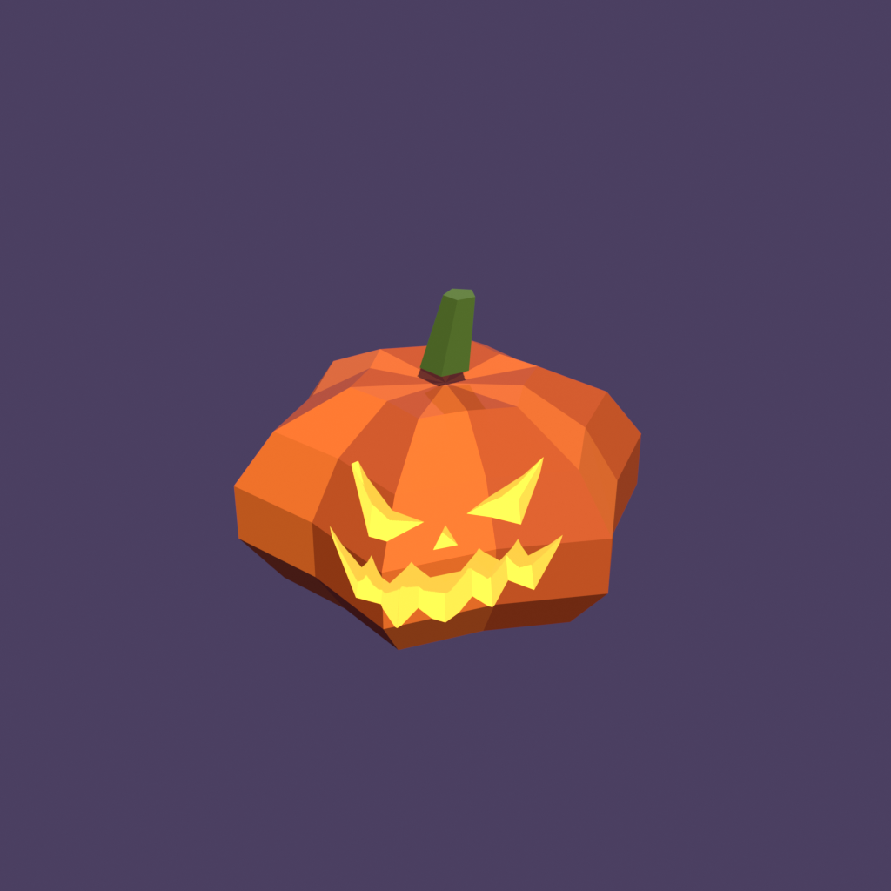 | 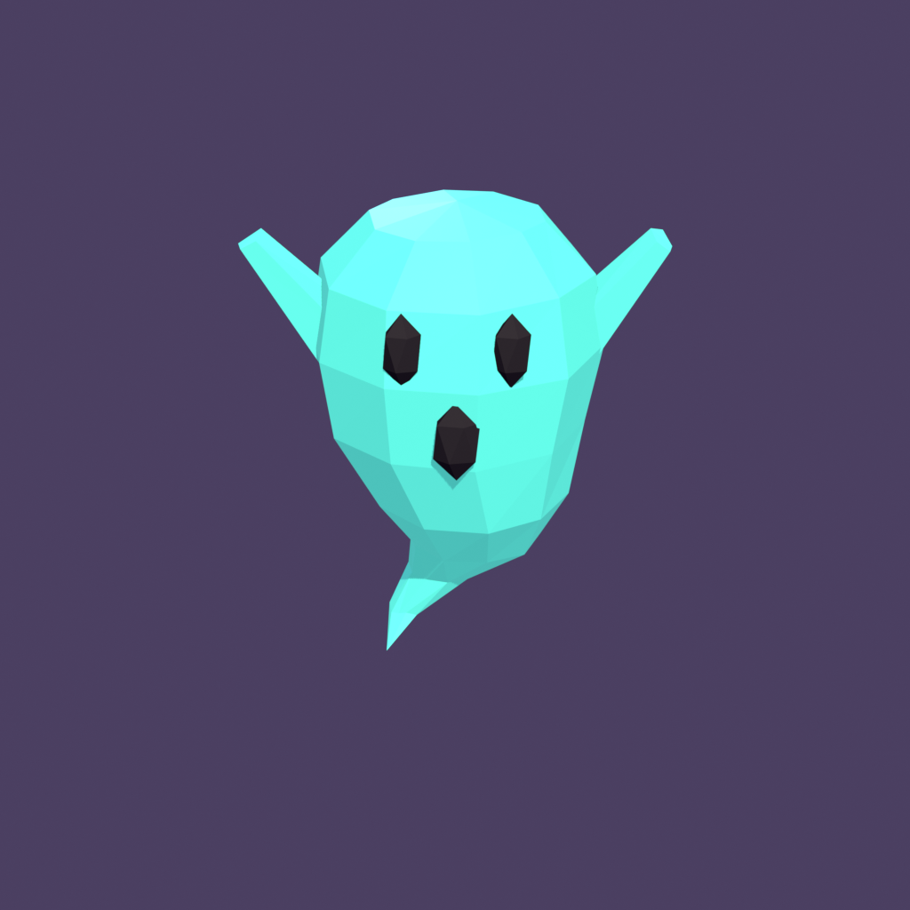 | 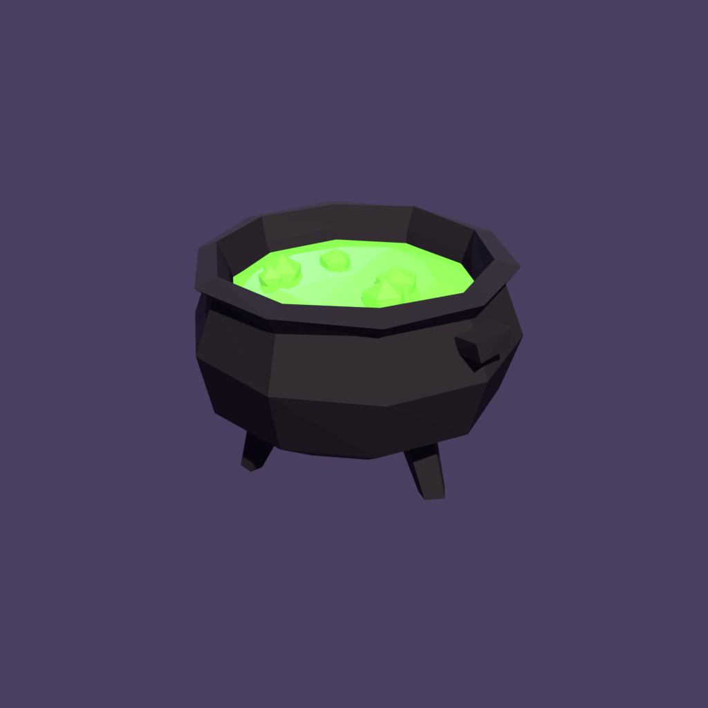 |
| 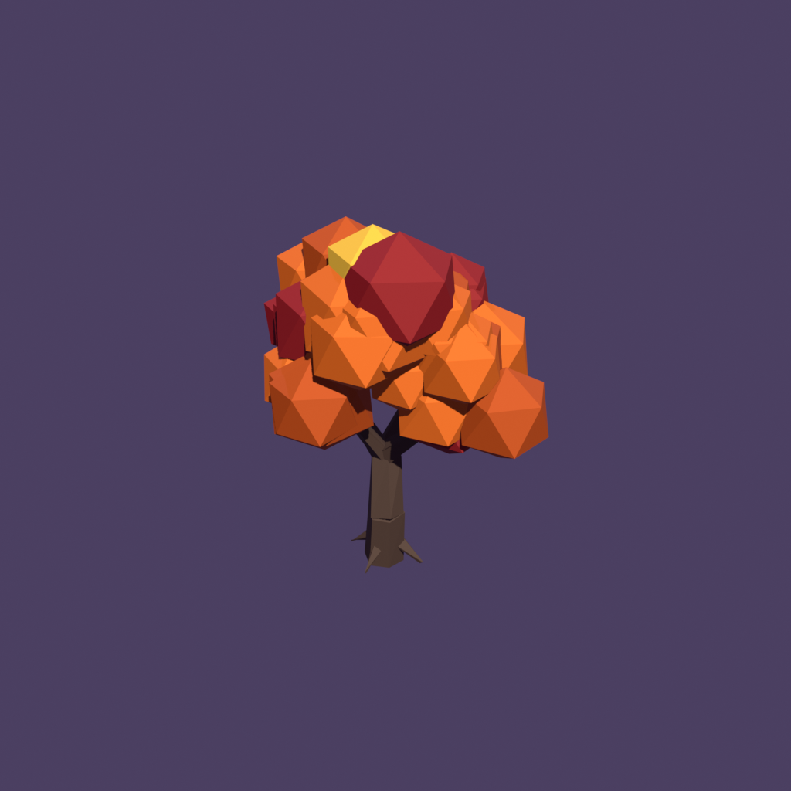 | 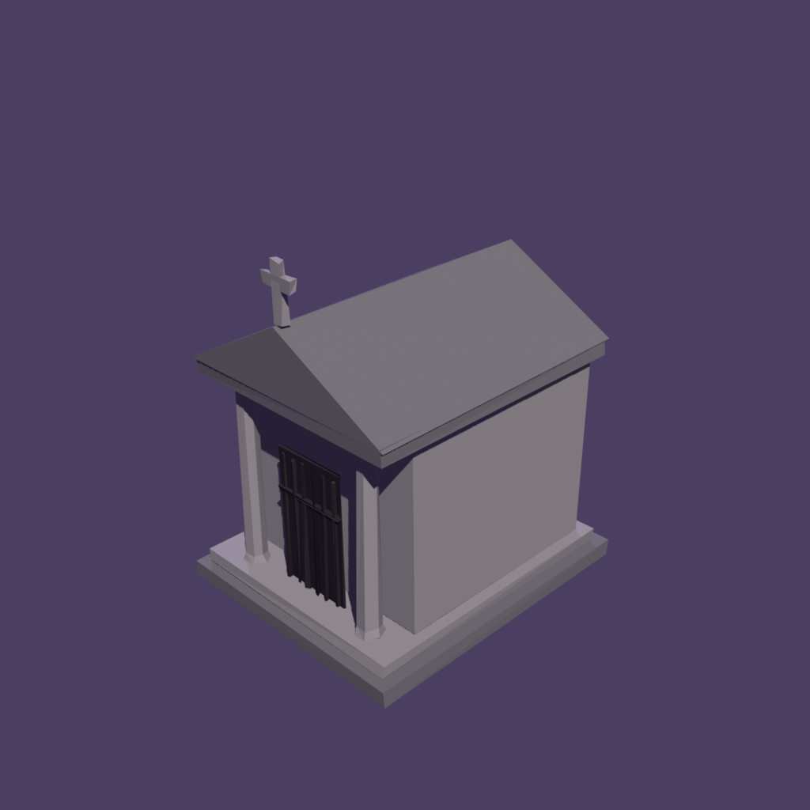 | 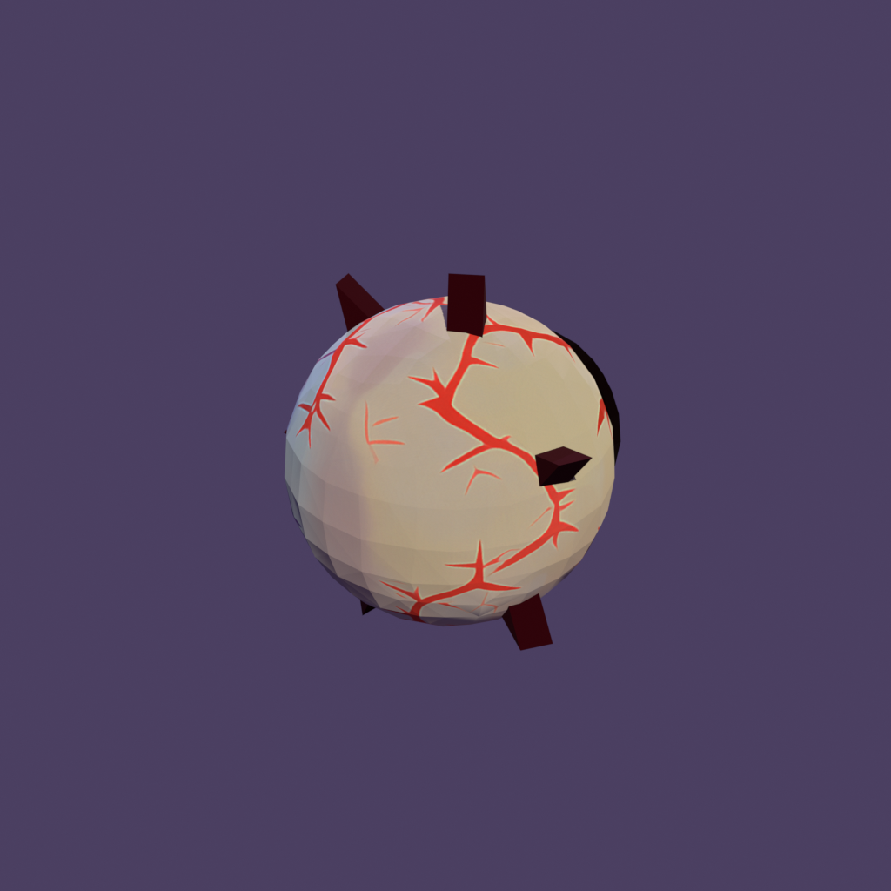 | 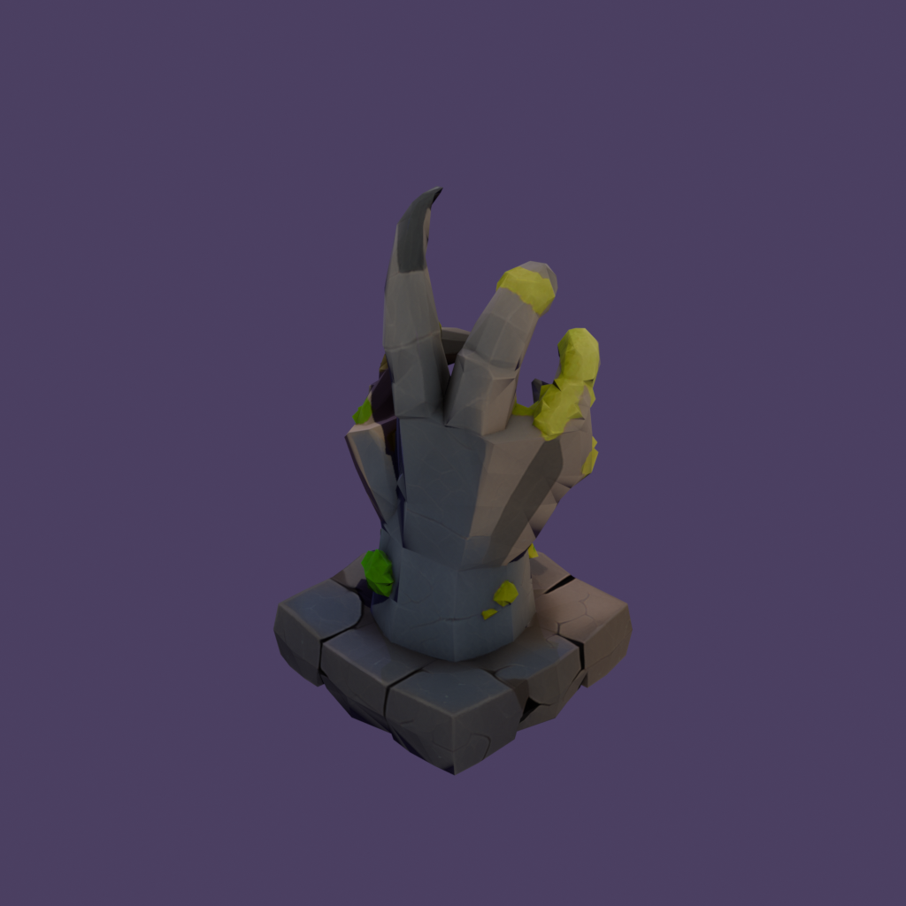 |

## Get the pack

This repository is a showcase only. The models, textures and scripts are sold separately and are not
included here.

© 2026 sumiii61. All rights reserved. The images in this repository may not be reused or redistributed.
